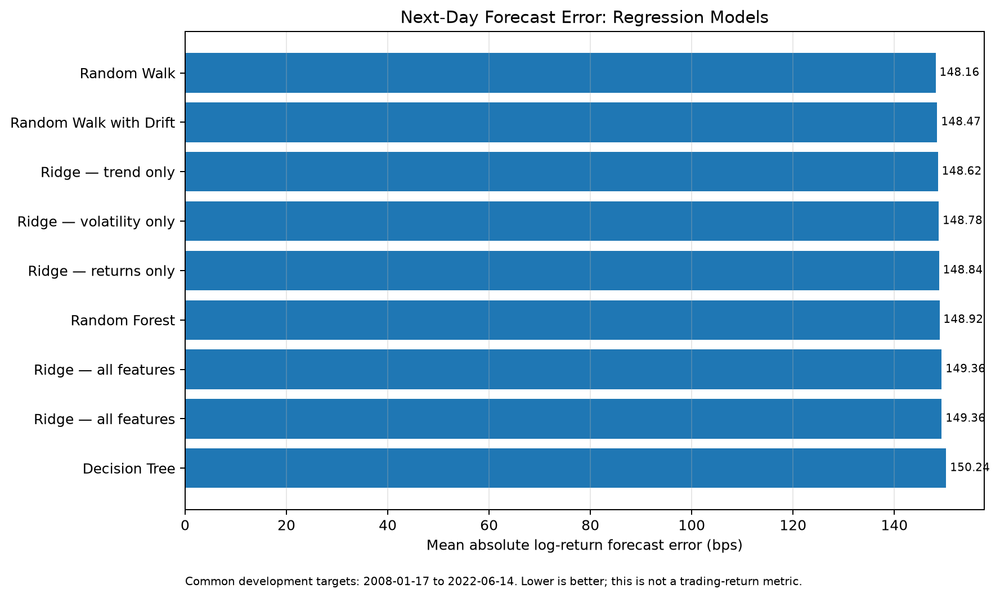
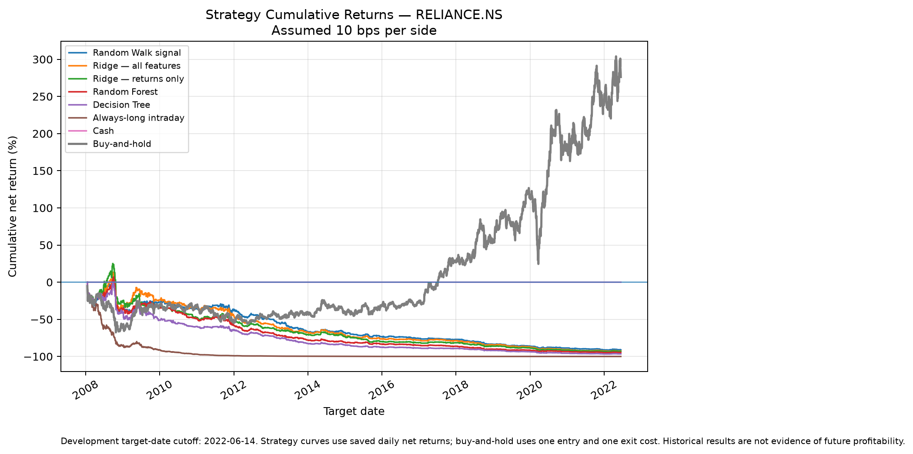
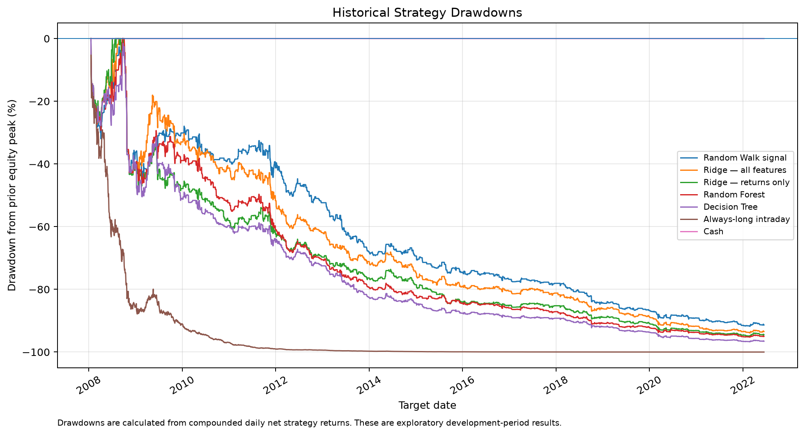
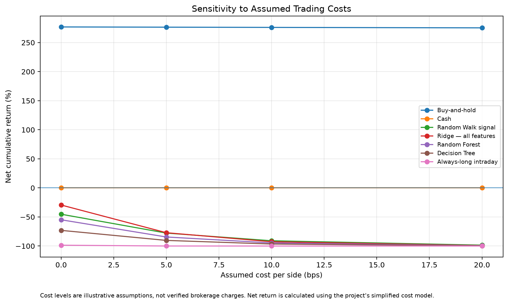

# PriceForecastLab — Stock Forecast & Backtesting Lab

[](https://price-forecast-lab.streamlit.app/) [](https://github.com/avgphoenixguy/stock-forecast-backtesting-lab)

A Python-based quantitative research project investigating whether machine learning can improve next-day stock return forecasts and whether forecast-driven trading strategies can outperform simple benchmarks after transaction costs.

The project uses historical data for Reliance Industries Limited (`RELIANCE.NS`), with chronological walk-forward validation, baseline comparisons, feature experiments, and an exploratory trading-strategy backtest.

## Live Dashboard

**[Launch PriceForecastLab](https://price-forecast-lab.streamlit.app/)** to explore the research interactively.

- **Price Forecast:** review next-session price estimates from all models that completed, compare forecast disagreement, and inspect individual model diagnostics.
- **Forecast tracking:** see scored predictions once the next observed session's actual close becomes available, compare model errors, and download the recent forecast log.
- **Research Lab → Overview / Model comparison:** review fixed historical model results and classification metrics.
- **Research Lab → Strategy backtest / Daily decisions:** explore historical cumulative-return and drawdown charts, transaction-cost scenarios, and saved daily decisions.

The public app is forecast-first. It displays the latest forecast output published by GitHub Actions from validated daily adjusted OHLC, and separates that product view from the historical **Research Lab**. The browser does not download prices or fit models on each page load, and no trades are placed. Transaction-cost settings apply only to historical strategy estimates; they do not change price forecasts or forecast-error metrics.

## Automated Daily Forecasts

A GitHub Actions workflow is configured in `.github/workflows/daily-forecast.yml`. It is scheduled for weekdays at approximately **8:00 PM India Standard Time** and can also be started manually from the repository's **Actions** tab.

On a successful run, the workflow:

1. Runs the project test suite.
2. Installs the separate forecasting dependencies in `requirements-forecast.txt`, including statsmodels and TensorFlow CPU.
3. Downloads and validates the latest available daily adjusted OHLC history for `RELIANCE.NS`.
4. Scores prior recorded forecasts when the next observed trading session is available.
5. Attempts a focused suite of daily forecasts: Random Walk, Random Walk with Drift, ARIMA(1,1,1), Holt damped-trend exponential smoothing, Ridge Regression, Random Forest, Histogram Gradient Boosting, LSTM, and GRU.
6. Builds an unweighted median-return ensemble from the models that successfully produce a forecast.
7. Publishes the latest forecast JSON and dated forecast-history CSV to `dashboard/data/` for the hosted app.

Individual model failures are recorded in the latest forecast diagnostics; one unavailable model should not hide results from other models. The ensemble is a transparent baseline aggregation, not a proven or optimized trading strategy.

The data provider is Yahoo Finance accessed through `yfinance`. Data availability and scheduled GitHub Actions execution are not guaranteed at an exact time. The workflow rejects stale data rather than intentionally generating a new forecast from a dataset older than its configured freshness limit. Check the Actions run history for success or failure.

**Daily forecast scope:** the scheduled workflow attempts the models listed above, but the live page only displays models that succeed on a particular run. LSTM/GRU runs use modest fixed architectures and need their own rolling walk-forward evaluation before they should be interpreted as competitive models. The historical multi-model backtest and comparison tables remain the documented development experiment ending June 14, 2022; the daily process does not silently extend or replace that experiment. Daily forecasts are research records, not trading signals or guarantees of performance.

**Research conclusion:** The tested machine-learning models did not outperform the Random Walk benchmark on overall return forecast errors. The initial forecast-driven trading rule also performed poorly after costs. These negative results are documented rather than presented as a successful trading system.

## Project Overview

The research pipeline covers:

- Historical stock-price acquisition and data validation.
- Random Walk and Random Walk with Drift benchmarks.
- ARIMA(1,1,1) and Holt damped-trend exponential smoothing for econometric baselines.
- Ridge Regression, Random Forest and Histogram Gradient Boosting for next-session returns.
- LSTM and GRU recurrent neural networks in the scheduled daily forecast job.
- A transparent median-return ensemble over successful models.
- Logistic Regression for next-day price direction.
- Ridge Regression for next-day log-return forecasts.
- Ridge feature ablation across returns, trend, and volatility.
- Decision Tree and Random Forest regression.
- Common-date model comparison.
- An exploratory long-or-cash intraday strategy backtest.
- Transaction-cost sensitivity and buy-and-hold benchmarking.
- Research charts generated from saved experiment outputs.

## Research Results

### 1. Regression Model Comparison

The models below were evaluated on the same 3,549 forecast target dates, from January 17, 2008, through June 14, 2022.

| Model | Return MAE (bps) | Return RMSE (bps) |
|---|---:|---:|
| Random Walk | 148.1620 | 211.0291 |
| Random Walk with Drift | 148.4689 | 211.3435 |
| Ridge — trend only | 148.6181 | 211.8300 |
| Ridge — volatility only | 148.7750 | 211.7985 |
| Ridge — returns only | 148.8383 | 211.7502 |
| Random Forest | 148.9179 | 212.0404 |
| Ridge — all features | 149.3567 | 212.0487 |
| Decision Tree | 150.2362 | 214.6078 |

*Lower MAE and RMSE indicate smaller forecast errors. Return errors are measured in basis points of log return.*

The Random Walk benchmark achieved the lowest overall return MAE and RMSE. None of the tested regression models established an overall forecasting advantage over this simple baseline.



### 2. Logistic Regression

Logistic Regression was evaluated separately as a next-day direction classifier.

| Metric | Logistic Regression | Constant 50% Probability Baseline |
|---|---:|---:|
| Accuracy | 49.99% | Not applicable |
| ROC-AUC | 0.5002 | 0.5000 |
| Brier score | 0.2520 | 0.2500 |
| Log loss | 0.6973 | 0.6931 |

The classifier did not demonstrate a useful overall predictive advantage. Its accuracy was also below the 50.38% accuracy of the always-predict-up benchmark.

Direction classification and continuous return forecasting measure different objectives. Neither metric alone establishes profitability.

### 3. Exploratory Trading-Strategy Backtest

A fixed long-or-cash intraday strategy was evaluated using existing model forecasts. The strategy entered long at the session open only when forecast-implied upside exceeded the assumed round-trip costs, then exited at the close. Otherwise, it remained in cash.

Results for January 17, 2008, through June 14, 2022:

| Strategy | Gross Cumulative Return | Net Cumulative Return |
|---|---:|---:|
| Buy-and-hold | +276.90% | +276.12% |
| Cash, zero interest | 0.00% | 0.00% |
| Random Walk signal | -45.28% | -90.95% |
| Ridge — all features | -29.44% | -92.59% |
| Random Forest signal | -54.86% | -94.66% |
| Decision Tree signal | -73.06% | -96.54% |

The main scenario assumed transaction costs and slippage of 10 basis points per side. This is an illustrative assumption, not a verified brokerage tariff.





The tested forecast-driven rule was unsuccessful. Its gross cumulative return was negative even before transaction costs, and the strategy showed severe drawdowns.

Buy-and-hold has a different exposure and risk profile, so the comparison is not perfectly risk-matched. The cost deductions are simplified and do not model every actual trading fee, tax, liquidity effect, or market impact.

### 4. Transaction-Cost Sensitivity

The strategy was also assessed at assumed costs of 0, 5, 10, and 20 basis points per side.



Increasing assumed costs worsened the outcomes substantially. Even without transaction costs, the forecast-driven strategies had negative gross cumulative returns under the tested rule.

These results do not support a claim of trading profitability.

## Methodology

### Data

- **Instrument:** Reliance Industries (`RELIANCE.NS`)
- **Source:** Yahoo Finance, accessed through `yfinance`
- **Frequency:** Daily
- **Price field:** Adjusted OHLC data
- **Research start:** January 1, 2005
- **Development target-date cutoff:** June 14, 2022

The downloader saves a historical CSV alongside metadata containing data-validation information and a SHA-256 file hash. Forecasting scripts validate the saved dataset before running.

### Feature Engineering

The regression models use historical features calculated from information available at the forecast origin:

- Log returns over 1, 5, 20, and 60 trading sessions.
- Rolling volatility over 20 and 60 sessions.
- Closing-price distance from the 20-session and 60-session simple moving averages.

Ridge Regression uses feature and target scaling fitted on the available training window. Tree-based models use fixed configurations for their initial comparisons.

### Validation

The core regression and classification experiments use expanding-window, one-day-ahead forecasts. The initial training window is 756 observations.

Both forecast origins and target dates are restricted to the development period. Training targets must already be observable at each forecast origin. This is intended to prevent future target information from leaking into model fitting.

The previously examined June 15, 2022–October 23, 2026 period is **not treated as an untouched final holdout**. It must not be repeatedly reused to tune these models or trading rules.

## Getting Started

### Requirements

- Python
- Git
- A network connection for downloading historical data

The project uses NumPy, pandas, yfinance, scikit-learn, Streamlit, Matplotlib, Plotly, and pytest.

### Installation

Clone the repository:

```bash
git clone https://github.com/avgphoenixguy/stock-forecast-backtesting-lab.git
cd stock-forecast-backtesting-lab
```

Create and activate a virtual environment on macOS or Linux:

```bash
python3 -m venv .venv
source .venv/bin/activate
```

Install dependencies:

```bash
python -m pip install -r requirements.txt
```

For the full scheduled multi-model forecast suite—including ARIMA, Holt damped-trend smoothing, LSTM and GRU—install the additional forecast dependencies as well:

```bash
python -m pip install -r requirements-forecast.txt
```

The Streamlit dashboard itself reads published forecast outputs, so the heavier TensorFlow dependency is installed in the daily forecast workflow rather than being required for the basic dashboard UI.

### Download Historical Data

Download maximum available daily history for Reliance Industries:

```bash
python scripts/download_data.py --ticker RELIANCE.NS
```

Downloaded data is saved locally under `data/raw/`.

### Run the Forecasting Experiments

Run the chronological baseline:

```bash
python scripts/run_walk_forward.py \
  --ticker RELIANCE.NS \
  --start 2005-01-01 \
  --end 2022-06-14
```

Run Ridge Regression:

```bash
python scripts/run_ridge_baseline.py \
  --ticker RELIANCE.NS \
  --start 2005-01-01 \
  --end 2022-06-14
```

Run the Ridge feature ablation:

```bash
python scripts/run_ridge_ablation.py \
  --ticker RELIANCE.NS \
  --start 2005-01-01 \
  --end 2022-06-14
```

Run the Decision Tree:

```bash
python scripts/run_tree_baseline.py \
  --ticker RELIANCE.NS \
  --start 2005-01-01 \
  --end 2022-06-14
```

Run Random Forest:

```bash
python scripts/run_random_forest.py \
  --ticker RELIANCE.NS \
  --start 2005-01-01 \
  --end 2022-06-14
```

Run Logistic Regression:

```bash
python scripts/run_logistic_baseline.py \
  --ticker RELIANCE.NS \
  --start 2005-01-01 \
  --end 2022-06-14
```

Compare saved forecasts on common target dates:

```bash
python scripts/compare_model_results.py \
  --ticker RELIANCE.NS \
  --end 2022-06-14
```

Run the exploratory backtest and cost-sensitivity analysis:

```bash
python scripts/run_strategy_backtest.py \
  --ticker RELIANCE.NS \
  --end 2022-06-14 \
  --cost-bps 10

python scripts/evaluate_strategy_backtest.py \
  --ticker RELIANCE.NS \
  --end 2022-06-14
```

Generate the research charts:

```bash
python scripts/create_research_charts.py \
  --ticker RELIANCE.NS \
  --end 2022-06-14
```

Generated experiment reports are written under `reports/`. Downloaded market data and generated CSV/JSON reports are excluded from version control by the repository's ignore rules.

### Run Tests

Activate the virtual environment and run:

```bash
python -m pytest
```

The existing test suite previously passed 12 tests. Run the suite in your current checkout to confirm the latest state.

## Repository Structure

```text
stock-forecast-backtesting-lab/
├── data/
│   ├── raw/                 # Local historical data
│   └── processed/           # Optional processed datasets
├── docs/
│   ├── assets/              # Published research charts
│   ├── experiment_log.md
│   ├── ridge_ablation_results.md
│   ├── tree_baseline_results.md
│   ├── random_forest_results.md
│   ├── model_comparison_results.md
│   └── strategy_backtest_results.md
├── reports/                 # Generated local experiment outputs
├── scripts/
│   ├── download_data.py
│   ├── run_baselines.py
│   ├── run_walk_forward.py
│   ├── run_logistic_baseline.py
│   ├── evaluate_logistic_results.py
│   ├── run_ridge_baseline.py
│   ├── run_ridge_ablation.py
│   ├── run_tree_baseline.py
│   ├── run_random_forest.py
│   ├── compare_model_results.py
│   ├── run_strategy_backtest.py
│   ├── evaluate_strategy_backtest.py
│   └── create_research_charts.py
├── tests/
├── .gitignore
└── requirements.txt
```

## Limitations and Future Work

This is an educational quantitative-research project, not a production trading system.

- Historical forecasts and returns do not establish future performance.
- The development period has already been used to compare multiple models and strategy rules.
- Transaction costs and slippage require more precise market- and broker-specific modelling.
- The strategy comparison does not fully match the exposure and risk of each benchmark.
- The repository does not establish a positive predictive or economic edge.

Future research should begin with a specific economic hypothesis and a predeclared evaluation procedure, rather than adding models or changing parameters until an attractive historical result appears.

## Disclaimer

For educational and research purposes only. This repository does not provide investment advice, trading recommendations, or guarantees of performance. The strategies have not been established as profitable and should not be used for live trading without substantially more validation.
